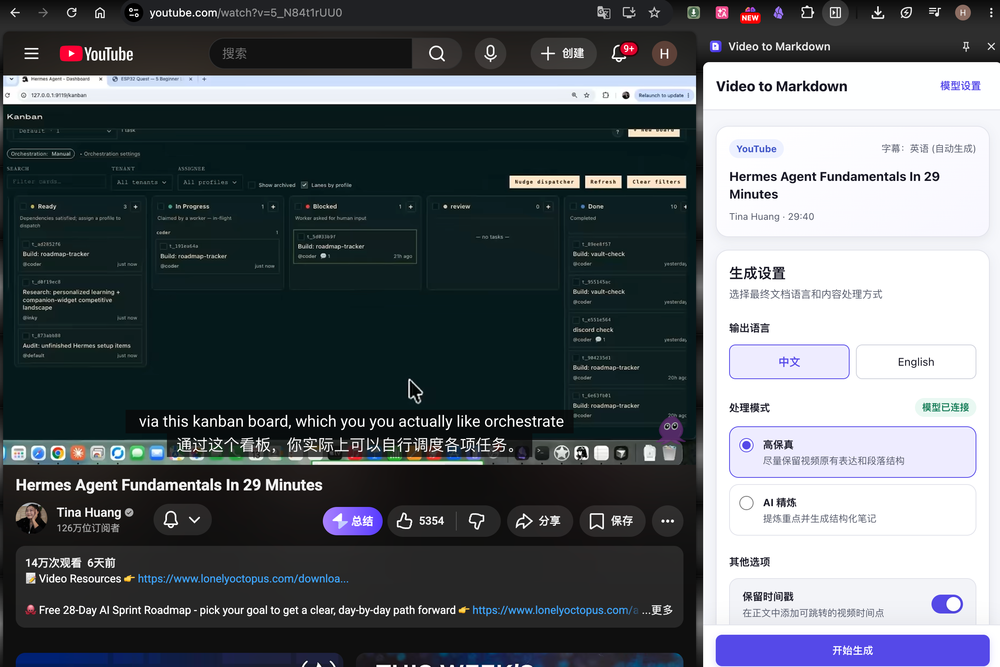

<div align="center">
  <h1>Video to Markdown</h1>
  
  <p>
    <a href="https://github.com/sanqi-cd/video-to-markdown-extension/actions/workflows/ci.yml"></a>
    <a href="https://github.com/sanqi-cd/video-to-markdown-extension/releases"></a>
    <a href="./LICENSE"></a>
  </p>
</div>

将 YouTube、哔哩哔哩字幕转换为中文或英文 Markdown 文档的本地优先 Chrome 插件；B站没有字幕轨时，也可由用户主动从当前标签页音频生成转写。当前稳定版本为 **0.2.1（Side Panel 2.0）**，直接音频转写位于开发分支。

## 产品展示



## 核心能力

- **高保真提取**：清洗字幕、恢复自然段并尽量保留原始信息顺序；同语言输出完全本地处理，跨语言时调用模型翻译。
- **AI 精炼笔记**：提取事实、观点、人物、案例和论证关系，生成中文或英文结构化文档。
- **实时可见**：展示字幕读取、分段、模型连接、接收字符数和已验证内容，不再让长任务成为黑盒。
- **安全降级**：模型支持 SSE 时逐步接收内容；不支持流式时自动退回分块增量，不影响最终结果。
- **失败可恢复**：临时错误自动重试，单个分块失败不会清空成功内容，并可只重试失败部分。
- **Markdown 导出**：支持阅读预览、源码查看、复制、下载以及可选原视频时间戳。
- **发布者文稿恢复**：B站没有字幕轨时，可自动检查当前 UP 主在简介、置顶评论和 B 站文稿中明确提供的完整文字。
- **转载视频原字幕**：B站视频没有可访问字幕时，可手动填写完整的 YouTube 原视频链接，并使用该视频已有字幕生成文档。
- **当前视频音频转写**：无需寻找原视频链接，从当前 B 站标签页音频分段生成带时间戳的临时字幕，再进入同一 Markdown 流程。

## 支持范围

- YouTube：`www.youtube.com`
- 哔哩哔哩：`www.bilibili.com`
- Chrome 116 及以上版本
- DeepSeek、OpenAI、OpenRouter 和自定义 OpenAI 兼容 `/chat/completions` 服务
- OpenAI 兼容的 `/audio/transcriptions` 语音转写服务（无字幕视频可选）

插件优先处理平台已有字幕和当前 B 站 UP 主明确提供且用户有权访问的文本型文稿。无字幕时，仅在用户明确点击后捕获当前标签页音频，并将分段直接发送到用户配置的转写服务；项目没有自有中转服务器。

## 首次使用

1. 在 Chrome 扩展管理页开启“开发者模式”，加载解压后的 `.output/chrome-mv3` 目录。
2. 打开带字幕的 YouTube 或哔哩哔哩视频，点击插件图标打开侧边栏。
3. 如果页面在安装或更新插件前已经打开，点击侧边栏中的“刷新并重新检测”。
4. 选择输出语言、生成方式和时间戳选项；字幕来源默认自动选择，可在高级设置中覆盖。
   如果B站视频没有字幕轨，可配置语音转写服务并点击“开始直接转录”；不希望发送音频时，也可自动查找发布者文稿或填写完整的 YouTube 原视频链接。
5. 点击“开始生成”。生成过程会持续显示阶段、进度和已经验证的正文。
6. 完成后可切换阅读预览或 Markdown 源码，并复制或下载 `.md` 文件。

### 什么时候需要配置模型

| 使用场景 | 是否需要模型 |
| --- | --- |
| 字幕语言与输出语言相同 + 高保真 | 不需要，完全本地处理 |
| 字幕语言与输出语言不同 + 高保真 | 需要 |
| 任意语言 + AI 精炼 | 需要 |

只有当前任务需要模型时，插件才会引导进入模型设置。填写 API Key、HTTPS Base URL、模型名称和上下文窗口后，可选择“仅保存”或“保存并测试”。插件只申请访问该 Base URL 对应来源的权限。

## 增量输出说明

- 每个完整且通过校验的分块会立即进入实时预览。
- 支持 OpenAI 兼容 SSE 的服务可以进一步按语义单元逐步展示内容。
- 服务明确不支持流式时，“自动”模式会改用普通请求和分块增量。
- 流连接在输出过程中异常中断时，未验证内容会被丢弃，当前分块按重试策略处理，不会把残缺 JSON 写入文档。

## 安装

从 [GitHub Releases](https://github.com/sanqi-cd/video-to-markdown-extension/releases) 下载当前版本的 Chrome ZIP，解压后在 `chrome://extensions` 开启开发者模式并选择“加载未打包的扩展程序”。

完整步骤、模型配置和常见问题见 [安装与使用指南](./docs/安装使用指南.md)。

## 本地开发

```bash
pnpm install
pnpm dev        # 开发模式
pnpm lint       # ESLint
pnpm typecheck  # 应用和 E2E TypeScript 检查
pnpm test       # 单元、组件与集成测试
pnpm test:coverage # 覆盖率与门槛检查
pnpm build      # 生产构建
pnpm test:e2e   # Chrome 扩展端到端测试
pnpm zip        # 生成可安装 ZIP
```

首次运行 E2E 前安装 Chromium：

```bash
pnpm exec playwright install chromium
```

生产目录为 `.output/chrome-mv3`，发布 ZIP 位于 `.output/video-to-markdown-extension-<version>-chrome.zip`。

## 权限与隐私

- `sidePanel`：显示插件侧边栏。
- `storage`：在本机保存模型配置和界面偏好。
- `downloads`：保存 Markdown 文件。
- `tabCapture`：仅在用户点击“开始直接转录”后捕获当前 B 站标签页音频。
- `offscreen`：在后台维持音频采集、分段和转写，不采集画面。
- 平台页面与字幕域名：读取当前视频元数据和字幕。
- 可选模型来源权限：仅在用户配置模型地址后申请。

API Key 保存在 `chrome.storage.local`，并限制为扩展可信上下文访问，不会进入网页、Content Script、日志或导出文档。需要文本模型的任务会把字幕文本直接发送给用户选择的模型服务商；直接转录任务会把音频分段发送给用户单独配置的语音转写服务。字幕语言与输出语言相同的高保真排版不会再次发送字幕。项目没有自有中转服务器。详见 [隐私说明](./PRIVACY.md) 与 [安全说明](./SECURITY.md)。

## 已知限制

- 当前视频音频转写按实时速度从头播放，整体耗时接近视频时长，并产生用户所选转写服务的调用费用。
- 当前仅使用音频 ASR，不识别烧录在画面里的硬字幕；画面 OCR 和 ASR/OCR 对齐校正列入后续版本。
- 充电专属、粉丝专属等文稿必须由用户在 B 站正常取得访问权限，插件不会绕过平台限制。
- 图片型文稿暂不执行 OCR；过短的视频简介或摘要不会被当作完整转录。
- 手动关联 YouTube 原视频只会读取该视频已有字幕，不会识别B站画面中的硬字幕。
- 文本生成支持 OpenAI 兼容的 `/chat/completions`；开发版音频转写支持 `/audio/transcriptions`，以及火山方舟 `/api/v3/responses` 音频输入。方舟模式在本地转换为 WAV，使用录音分段级时间戳，模型需具有音频输入权限，真实转录效果仍需验收。

### 火山方舟音频转写（开发版）

打开插件或切换视频时会自动检测字幕，并在生成前检查正文和时间覆盖。视频卡上的“重新检测”只重新读取数据，不会刷新视频网页。没有字幕与字幕异常分别提示；B 站可在恢复页配置语音识别。网络读取失败只提示重试，不会误判为无字幕。基础校验不能保证字幕语义与视频完全一致。

在无字幕视频的“直接转录当前视频”中，选择“火山方舟 Responses（音频）”。默认接口为 `https://ark.cn-beijing.volces.com/api/v3/responses`，默认模型为 `doubao-seed-2-0-lite-260428`。请在插件内填写自己的新 API Key，不要提交到仓库或粘贴在 Issue 中。切换接口类型会清空表单密钥，防止误发到其他服务。

该模式请求设置 `store: false`，但这不代表服务商完全不保留安全审计等日志，具体以服务商政策为准。建议先转录 30～60 秒，核对原声和文字后再处理长视频。当前不会识别画面中的译文，也不提供逐词时间戳。
- 平台页面或字幕接口变化时，适配器可能需要更新。
- 关闭 Side Panel 会取消当前请求；本次打开期间已经验证的内容会用于部分结果，但不提供关闭后的后台续跑或跨会话恢复。
- 不支持播放列表批量处理、飞书/Notion 同步和多设备任务历史。

## 开源协作

提交代码前请阅读 [贡献指南](./CONTRIBUTING.md) 与 [贡献者公约](./CODE_OF_CONDUCT.md)。版本变化见 [CHANGELOG.md](./CHANGELOG.md)，安全问题请按 [SECURITY.md](./SECURITY.md) 私下报告。

本项目使用 [MIT License](./LICENSE)。
